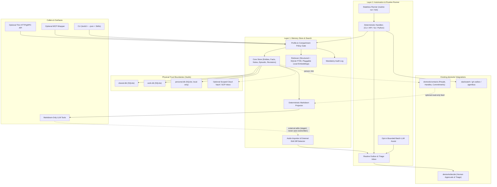
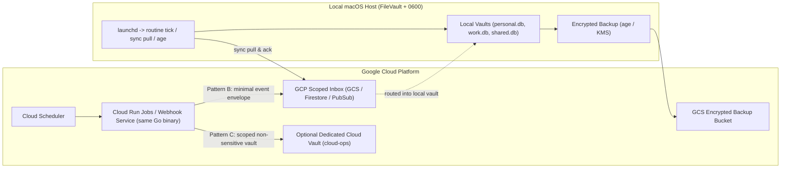

# Personal Memory Store & Deterministic Automation — Architecture & Design

## 1. Executive Summary

This document specifies a two-layer personal memory and automation system built in Go under `devtools/` (reusing `devtools/pkg/sqlitedb` and `devtools/pkg/toolcli`). It is inspired by markdown-first agent memory architectures (such as Aside-style memory directories and scheduled agent routines) while solving their core performance, efficiency, and privacy limitations:

1. **Database as Source of Truth, Markdown as Projection**: Structured entities, aliases, typed facts, append-only episodic events, and routine state live in SQLite instead of prose-only Markdown files. Unstructured/overflow notes are stored alongside structured fields without duplication. A deterministic renderer projects database state into Aside-compatible Markdown trees so Markdown-only LLM tools continue to work seamlessly.
2. **Hard Context Compartmentalization**: Separate physical SQLite vault files enforce hard trust boundaries (for example, `work`, `personal`, `shared`), while row-level compartment and sensitivity tags enforce fine-grained filtering inside each vault. Callers must declare an explicit, default-deny profile—preventing cross-domain context leakage (such as personal or financial details entering a work LLM prompt).
3. **Deterministic API/Tool Automation First**: Slow, expensive per-turn LLM extraction loops and browser-driven LLM routines are replaced by deterministic CLI/API handlers, structured routine state/cursors, rule-based aging/compaction, and optional bounded batch LLM assistance routed through human triage (`devtools/decide`).
4. **Local-First with Selective GCP Offloading**: Sensitive vaults remain strictly local on macOS. Always-on or webhook-driven automations can deploy as lightweight Go Cloud Run Jobs/Services on GCP using either a scoped GCP inbox pulled by the local host or a dedicated scoped cloud vault containing only minimum required context.

---

## 2. System Architecture

The system consists of **two cleanly separated layers** sharing a single Go core library and integrating with existing `devtools/` utilities:



### Design Principles

- **Zero Duplication**: Structured attributes (handles, URLs, schedules, status, timestamps) live in typed DB columns/tables; free-form prose and playbooks live in complementary `note_blocks`. Markdown exports synthesize both cleanly.
- **Default-Deny Context Isolation**: No profile means no access. Every query, search, routine run, and Markdown export executes inside a resolved profile boundary.
- **Deterministic Core, Optional Bounded LLM**: Reads, writes, resolution, BM25 search, routine cursors, and retention aging require zero LLM tokens and execute in milliseconds.
- **Composable with `devtools/`**: Reuses `devtools/contacts` for specialized people/commitment tracking, `devtools/decide` for approvals and triage, `devtools/pkg/sqlitedb` for cgo-free SQLite, and `devtools/pkg/toolcli` for standard CLI/skill management.

---

## 3. Context Separation, Privacy & Security Model

### 3.1 Two-Tier Isolation

| Tier | Mechanism | What It Protects Against | Examples |
|---|---|---|---|
| **Tier 1: Physical Vaults** | Separate SQLite `.db` files per hard trust boundary | Sandboxed agents, remote machines, or GCP containers ever having filesystem/network access to restricted data | `shared.db`, `work.db`, `personal.db`, `cloud-ops.db` |
| **Tier 2: Row-Level Compartments & Sensitivity** | `compartment` + `sensitivity` columns on every fact, note block, link, and episodic event | Cross-context leakage inside a vault (e.g., finance or relationship notes leaking into a general or professional prompt) | Compartments: `general`, `engineering`, `ops`, `finance`, `health`, `relationships`; Sensitivity: `public`, `normal`, `private`, `restricted` |

An entity (such as `user` or a dual-context `person`) can exist in a vault while individual `facts`, `note_blocks`, and `episodic_events` attached to it belong to different compartments. When queried under a restricted profile, only permitted facts and blocks are visible—non-permitted rows are filtered out in SQL before ranking, formatting, or LLM serialization.

### 3.2 Default-Deny Caller Profiles

Profiles are declared in local config (`$XDG_CONFIG_HOME/<tool>/config.toml`, never committed to git):

```toml
[vaults.shared]
path = "~/.local/share/memstore/vaults/shared.db"
residency = "local-only"

[vaults.work]
path = "~/.local/share/memstore/vaults/work.db"
residency = "local-only"

[vaults.personal]
path = "~/.local/share/memstore/vaults/personal.db"
residency = "local-only"

[profiles.work-agent]
vaults = ["shared", "work"]
compartments = ["general", "engineering", "ops"]
max_sensitivity = "normal"
capabilities = ["read", "write-episodic", "propose-fact"]

[profiles.personal-finance]
vaults = ["shared", "personal"]
compartments = ["general", "finance"]
max_sensitivity = "private"
capabilities = ["read", "write"]

[profiles.work-md-export]
vaults = ["shared", "work"]
compartments = ["general", "engineering", "ops"]
max_sensitivity = "normal"
capabilities = ["export"]
```

Enforcement rules:
- Every CLI invocation, API request, routine execution, and export **must** specify a profile (`--profile <name>` or `MEMSTORE_PROFILE`, with an explicit config option only if a minimal safe default is desired—never an implicit "all vaults" wildcard).
- Writes validate that the target `vault`, `compartment`, and `sensitivity` are allowed by the caller's profile.
- `propose-fact` capability restricts untrusted/LLM callers to inserting into `triage_inbox` rather than mutating canonical `facts` directly.

### 3.3 Filesystem, Git, Audit & Backup Guardrails

- **Permissions**: Vault directories are created with mode `0700`; SQLite files with mode `0600`.
- **Git Work-Tree Refusal**: Opening or initializing a vault inside a git repository fails with an error (mirroring `devtools/contacts`). Exporting Markdown into a git work tree also fails unless explicitly overridden with `--allow-git` (intended only for non-sensitive/shared documentation).
- **Mandatory Audit Log**: Every read (`get`, `resolve`, `search`, `export`) and write records `(ts, caller, profile, command, entity_id, reason)` in the vault's `access_log`. The log stores **only entity IDs and metadata—never entity names, fact values, or query content**.
- **Encryption**:
  - Live local SQLite files rely on OS full-disk encryption (macOS FileVault) plus `0600` permissions, keeping pure-Go `modernc.org/sqlite` cgo-free and Bazel-compatible.
  - Offsite backups (e.g., to GCS) are encrypted client-side using `age` or Cloud KMS before leaving the machine.

---

## 4. Layer 1: Memory Store Data Model

Each vault is a self-contained SQLite database opened via `devtools/pkg/sqlitedb` (`WAL` mode, `busy_timeout=5000`, `foreign_keys=1`), with forward-only numbered schema migrations.

### 4.1 Core Tables

```sql
-- Canonical entities aligned with Aside's taxonomy
CREATE TABLE entities (
  id                  TEXT PRIMARY KEY NOT NULL, -- e.g. "site:example-com", "project:apollo"
  kind                TEXT NOT NULL CHECK (kind IN (
                        'user', 'agent', 'person', 'company',
                        'site', 'project', 'concept', 'routine'
                      )),
  slug                TEXT NOT NULL,
  title               TEXT NOT NULL,
  contacts_ref        TEXT,                      -- optional person ID in devtools/contacts
  default_compartment TEXT NOT NULL DEFAULT 'general',
  sensitivity         TEXT NOT NULL DEFAULT 'normal' CHECK (
                        sensitivity IN ('public', 'normal', 'private', 'restricted')
                      ),
  summary             TEXT NOT NULL DEFAULT '',
  pinned_l1           INTEGER NOT NULL DEFAULT 0, -- included in rendered MEMORY.md
  created_at          INTEGER NOT NULL,
  updated_at          INTEGER NOT NULL,
  archived_at         INTEGER,
  UNIQUE (kind, slug)
);

-- Fast exact/prefix resolution across aliases
CREATE TABLE entity_aliases (
  entity_id        TEXT NOT NULL REFERENCES entities(id) ON DELETE CASCADE,
  alias            TEXT NOT NULL,
  normalized_alias TEXT NOT NULL,
  PRIMARY KEY (entity_id, normalized_alias)
);
CREATE INDEX idx_entity_aliases_norm ON entity_aliases(normalized_alias);

-- Structured attributes & durable facts (versioned via superseded_by)
CREATE TABLE facts (
  id            TEXT PRIMARY KEY NOT NULL,
  entity_id     TEXT NOT NULL REFERENCES entities(id) ON DELETE CASCADE,
  key           TEXT NOT NULL,              -- e.g. "url", "timezone", "cadence", "status"
  value_json    TEXT NOT NULL,              -- JSON scalar, array, or small object
  value_type    TEXT NOT NULL DEFAULT 'string',
  compartment   TEXT NOT NULL DEFAULT 'general',
  sensitivity   TEXT NOT NULL DEFAULT 'normal',
  confidence    REAL NOT NULL DEFAULT 1.0,
  source_type   TEXT NOT NULL,              -- "manual" | "routine" | "import" | "llm_proposal"
  source_ref    TEXT NOT NULL DEFAULT '',   -- URL, routine run ID, or message ID
  valid_from    INTEGER,
  valid_until   INTEGER,                    -- optional TTL for automatic aging
  superseded_by TEXT REFERENCES facts(id),
  created_at    INTEGER NOT NULL,
  updated_at    INTEGER NOT NULL
);
CREATE INDEX idx_facts_entity_active ON facts(entity_id, key) WHERE superseded_by IS NULL;
CREATE INDEX idx_facts_compartment ON facts(compartment, sensitivity);
CREATE INDEX idx_facts_valid_until ON facts(valid_until) WHERE valid_until IS NOT NULL;

-- Complementary unstructured prose / playbooks (non-duplicating)
CREATE TABLE note_blocks (
  id          TEXT PRIMARY KEY NOT NULL,
  entity_id   TEXT NOT NULL REFERENCES entities(id) ON DELETE CASCADE,
  section_key TEXT NOT NULL,                -- stable slug for section ordering & diffing
  heading     TEXT NOT NULL,                -- e.g. "Navigation Playbook", "Context"
  sort_order  INTEGER NOT NULL DEFAULT 100,
  body_md     TEXT NOT NULL,
  compartment TEXT NOT NULL DEFAULT 'general',
  sensitivity TEXT NOT NULL DEFAULT 'normal',
  updated_at  INTEGER NOT NULL,
  UNIQUE (entity_id, section_key)
);

-- Directed relationships between entities
CREATE TABLE entity_links (
  from_entity_id TEXT NOT NULL REFERENCES entities(id) ON DELETE CASCADE,
  relation       TEXT NOT NULL,             -- e.g. "works_at", "owns", "uses_site"
  to_entity_id   TEXT NOT NULL REFERENCES entities(id) ON DELETE CASCADE,
  compartment    TEXT NOT NULL DEFAULT 'general',
  sensitivity    TEXT NOT NULL DEFAULT 'normal',
  note           TEXT NOT NULL DEFAULT '',
  created_at     INTEGER NOT NULL,
  PRIMARY KEY (from_entity_id, relation, to_entity_id)
);

-- Append-only dated episodic log (replaces episodic/YYYY-MM-DD.md)
CREATE TABLE episodic_events (
  id                TEXT PRIMARY KEY NOT NULL,
  event_date        TEXT NOT NULL,          -- YYYY-MM-DD
  occurred_at       INTEGER NOT NULL,
  entity_id         TEXT REFERENCES entities(id) ON DELETE SET NULL,
  compartment       TEXT NOT NULL DEFAULT 'general',
  sensitivity       TEXT NOT NULL DEFAULT 'normal',
  channel           TEXT NOT NULL DEFAULT '', -- "cli", "email", "calendar", "code", "routine"
  source_ref        TEXT NOT NULL DEFAULT '', -- link/idempotency ref
  summary           TEXT NOT NULL,
  details_md        TEXT NOT NULL DEFAULT '',
  reporter          TEXT NOT NULL,
  compacted_into_id TEXT REFERENCES episodic_events(id),
  created_at        INTEGER NOT NULL
);
CREATE INDEX idx_episodic_date ON episodic_events(event_date, compartment);
CREATE INDEX idx_episodic_entity ON episodic_events(entity_id, occurred_at);

-- Compact revision log (replaces multi-hundred-MB full-content JSONL history)
CREATE TABLE revisions (
  id         INTEGER PRIMARY KEY AUTOINCREMENT,
  table_name TEXT NOT NULL,
  row_id     TEXT NOT NULL,
  op         TEXT NOT NULL CHECK (op IN ('insert', 'update', 'delete', 'supersede')),
  diff_json  TEXT NOT NULL,
  actor      TEXT NOT NULL,
  reason     TEXT NOT NULL DEFAULT '',
  created_at INTEGER NOT NULL
);
CREATE INDEX idx_revisions_row ON revisions(table_name, row_id, created_at);

-- Staging queue for Aside imports, external MD edits, and batch LLM proposals
CREATE TABLE triage_inbox (
  id                   TEXT PRIMARY KEY NOT NULL,
  source               TEXT NOT NULL,       -- "aside_import" | "md_external_edit" | "llm_batch"
  proposed_compartment TEXT NOT NULL,
  proposed_sensitivity TEXT NOT NULL DEFAULT 'normal',
  target_entity_id     TEXT,
  payload_json         TEXT NOT NULL,
  status               TEXT NOT NULL DEFAULT 'pending' CHECK (
                         status IN ('pending', 'approved', 'rejected')
                       ),
  decide_ref           TEXT,
  created_at           INTEGER NOT NULL,
  resolved_at          INTEGER
);
CREATE INDEX idx_triage_status ON triage_inbox(status, created_at);

-- Mandatory privacy-safe access log (never stores content or names)
CREATE TABLE access_log (
  id        INTEGER PRIMARY KEY AUTOINCREMENT,
  ts        INTEGER NOT NULL,
  caller    TEXT NOT NULL,
  profile   TEXT NOT NULL,
  command   TEXT NOT NULL,
  entity_id TEXT NOT NULL DEFAULT '',
  reason    TEXT NOT NULL DEFAULT ''
);
CREATE INDEX idx_access_log_ts ON access_log(ts);
```

### 4.2 Relationship with `devtools/contacts`

- `devtools/contacts` remains the authoritative store for work contact resolution (`handles`), contact-specific interaction history, and bidirectional `commitments`.
- In `entities` (`kind = 'person'`), `contacts_ref` optionally links to a `contacts` person ID (e.g., `mina-park`).
- When exporting `people/<slug>.md` or resolving a person, the Memory Store can optionally query `devtools/contacts` read-only (if configured for that profile) to render up-to-date handles, team, timezone, and open commitments—avoiding duplicate contact records.

---

## 5. Deterministic Markdown Projection & Aside Interoperability

### 5.1 One-Way Materialization (DB → Markdown)

Because some LLM systems (such as Aside Browser or file-based agent workspaces) only consume Markdown directories, the `export` command deterministically materializes a scoped view for any profile:

```text
<export-dir>/
├── MEMORY.md                     # Pinned L1 entity index & active summaries within profile
├── USER.md                       # Profile-scoped facts & note_blocks for entity kind=user
├── TAXONOMY.md                   # Generated read-only taxonomy reference
├── people/<slug>.md              # Frontmatter + structured facts (+ optional contacts) + note_blocks
├── companies/<slug>.md
├── sites/<slug>.md
├── projects/<slug>.md
├── concepts/<slug>.md
├── users/<slug>.md
├── agent/<slug>.md
├── episodic/YYYY-MM-DD.md        # Scoped daily events grouped by date
├── routines/<slug>/MEMORY.md     # Rendered routine state/cursors + routine note_blocks
└── .projection-manifest.json     # Per-file SHA-256 hashes & export metadata
```

Canonical entity page format:

```markdown
---
title: Example Service
aliases:
  - example.com
  - Example Portal
generated_by: memstore
profile: work-md-export
entity_id: site:example-com
---

# Example Service

## Structured Attributes

- **url**: https://example.com
- **auth_method**: sso
- **api_available**: true

## Navigation Playbook

*(rendered verbatim from `note_blocks` where `section_key = "navigation-playbook"` and compartment is permitted by profile)*
```

Key guarantees:
- **Deterministic & Idempotent**: Sorted keys, stable `sort_order`, and atomic rename-on-change (skipping files whose SHA-256 matches `.projection-manifest.json`).
- **Zero Duplication**: Structured attributes are rendered from `facts` (and `entity_links`), while free-form prose/playbooks come exclusively from `note_blocks`.
- **Strict Scope Filtering**: Exporting `work-md-export` produces a completely sanitized directory containing zero rows from `personal.db` or restricted compartments.

### 5.2 Migrating Aside Data & Handling External Edits

1. **Initial / Incremental Import (`import-aside`)**:
   - Reads an Aside-format memory directory (`MEMORY.md`, `USER.md`, entity folders, `episodic/YYYY-MM-DD.md`, `routines/<slug>/MEMORY.md`).
   - Parses YAML frontmatter (`title`, `aliases`), extracts structured fields where deterministic patterns match (URLs, dates, metadata tables), and preserves all remaining prose verbatim in `note_blocks` so re-exporting preserves full informational fidelity.
   - Supports dry-run classification rules (mapping paths/tags → target vault & compartment) and routes unclassified items into `triage_inbox` rather than auto-exposing them to agents.
2. **External Edit Detection (`sync-check`)**:
   - If Aside Browser or a human edits a generated `.md` file, `sync-check` compares file hashes against `.projection-manifest.json`, computes section-level diffs, and enqueues structured proposals into `triage_inbox`.
   - External Markdown edits **never** silently overwrite canonical structured DB fields.

---

## 6. Search & Retrieval Engine

### 6.1 Interface & v1 Implementation (Structured + SQLite FTS5)

```go
type Query struct {
    Profile      Profile
    Text         string
    Kinds        []EntityKind
    FactKey      string
    Since, Until *time.Time
    Limit        int
}

type Retriever interface {
    Search(ctx context.Context, q Query) ([]Hit, error)
}
```

- **v1 (`SQLiteRetriever`)**:
  - **Structured lookup**: O(1)/indexed resolution via `entities(kind, slug)`, `entity_aliases(normalized_alias)`, `facts(entity_id, key)`, and `episodic_events(event_date)`.
  - **FTS5 BM25 search**: A per-vault `fts_docs` FTS5 virtual table indexes `title`, `aliases`, `facts`, `note_blocks.body_md`, and `episodic_events.summary/details_md`. Queries enforce `compartment IN (...)` and `sensitivity <= ...` predicates in SQL before returning ranked snippets.
  - **Multi-vault fan-out**: Opens only the vaults permitted by `q.Profile`, executes queries concurrently, and merges/normalizes results in Go.

### 6.2 Optional v2 Extension (Per-Vault Local Embeddings)

- Embeddings are **opt-in per vault** and default to **disabled** so sensitive vaults remain 100% offline with zero ML runtime overhead.
- When enabled on a vault, a pluggable `Embedder` (e.g., local Ollama or local ONNX runtime—no cloud API required) computes dense vectors stored as quantized `int8`/`float16` BLOBs in a `chunk_embeddings` table inside the same SQLite DB.
- At personal memory scale (thousands to tens of thousands of chunks), brute-force cosine similarity in Go takes <2 ms in memory and combines with FTS5 via Reciprocal Rank Fusion (RRF)—eliminating the need for a separate vector database.

---

## 7. Layer 2: Deterministic Automation & Routine Runner

### 7.1 Thin Manifest + Real Code Handlers

Instead of inventing a complex YAML programming language or running slow LLM browser loops, each routine is declared by a concise manifest and implemented by a real executable (Go binary, Python script, or CLI wrapper around `gmail`, `gcalendar`, `gh`, `slackwatch`, HTTP APIs):

```toml
id = "weekly-pr-digest"
name = "Weekly PR & Review Digest"
schedule = "RRULE:FREQ=WEEKLY;BYDAY=MO;BYHOUR=9;BYMINUTE=0"
timezone = "America/Los_Angeles"
profile = "work-agent"
residency = "local"               # "local" | "gcp"
timeout = "2m"
idempotency = "date-hour"         # prevents duplicate runs on wake/retry

[handler]
command = ["my-pr-digest-handler", "--since", "{{cursor.last_run_iso}}"]
output_format = "json"            # handler emits structured state/events/proposals
```

### 7.2 Routine State, Run History & Outbox Tables

Stored in the routine's granted vault DB (eliminating markdown scraping of `routines/<slug>/MEMORY.md`):

```sql
CREATE TABLE routine_state (
  routine_id TEXT NOT NULL,
  key        TEXT NOT NULL,
  value_json TEXT NOT NULL,
  updated_at INTEGER NOT NULL,
  PRIMARY KEY (routine_id, key)
);

CREATE TABLE routine_runs (
  id              TEXT PRIMARY KEY NOT NULL,
  routine_id      TEXT NOT NULL,
  idempotency_key TEXT NOT NULL,
  trigger         TEXT NOT NULL,          -- "tick" | "manual" | "webhook" | "cloud_scheduler"
  started_at      INTEGER NOT NULL,
  finished_at     INTEGER,
  status          TEXT NOT NULL CHECK (status IN ('running', 'ok', 'failed', 'skipped')),
  exit_code       INTEGER,
  metrics_json    TEXT NOT NULL DEFAULT '{}',
  error_summary   TEXT NOT NULL DEFAULT '',
  UNIQUE (routine_id, idempotency_key)
);

CREATE TABLE routine_outbox (
  id           TEXT PRIMARY KEY NOT NULL,
  routine_id   TEXT NOT NULL,
  action_kind  TEXT NOT NULL,             -- e.g. "send_email", "post_slack", "api_mutate"
  payload_json TEXT NOT NULL,
  status       TEXT NOT NULL DEFAULT 'pending_approval' CHECK (
                 status IN ('pending_approval', 'approved', 'executed', 'rejected', 'failed')
               ),
  decide_id    TEXT,
  created_at   INTEGER NOT NULL,
  executed_at  INTEGER
);
```

### 7.3 Stateless Execution & Human-in-the-Loop

- **`routine run <id> [--dry-run]`**:
  1. Loads manifest and resolves `profile` (verifying vault/compartment grant).
  2. Acquires per-routine lock and checks `idempotency_key` in `routine_runs`.
  3. Passes current `routine_state` cursors to the handler (via stdin/env/flags).
  4. Executes handler with timeout and captures structured JSON response (`stateUpdates`, `events`, `facts`, `proposals`, `outboxActions`).
  5. Atomically commits allowed writes under the routine's profile, records `routine_runs`, and opens `devtools/decide` items for any `outboxActions` or `proposals`.
- **`routine tick`**:
  - Evaluates RRULE/cron schedules for local routines and invokes due runs.
  - Scheduled externally by macOS `launchd` (runs every 1–5 minutes; naturally catches up after sleep/wake with idempotency keys) or on GCP by **Cloud Scheduler → Cloud Run Jobs** (scales to zero when idle).
- **Escalation Tiers (Replacing LLM Browser Loops)**:
  1. **Tier 1 (Default)**: Direct APIs & CLIs (fast, reliable, deterministic).
  2. **Tier 2 (Bounded LLM Step)**: Narrow structured-output LLM call only for genuinely unstructured text (summarization/classification), fed strictly profile-filtered context and emitting proposals into `triage_inbox` / `routine_outbox`.
  3. **Tier 3 (Browser Fallback)**: Scripted/headless browser automation only when no API exists, reading structured `site` playbooks from the Memory Store.

---

## 8. Memory Maintenance: Ingestion, Aging & Batch Consolidation

1. **Direct Structured Ingestion**: Coding agents (via installed skills) and routines write structured `facts`, `note_blocks`, and `episodic_events` directly through the CLI/API—no per-turn transcript scraping.
2. **Deterministic Aging & Compaction (`age`)**:
   - Expires facts whose `valid_until < now` (marks superseded/archived).
   - Rolls up `episodic_events` older than `retention_days` into monthly summary events per `(entity_id, compartment)`, preserving source references (mirroring `devtools/contacts age`).
   - Prunes `revisions` and `access_log` rows past retention.
   - Triggers incremental Markdown projection for dirty profiles.
   - Idempotent and lock-guarded for safe scheduled execution.
3. **Opt-In Scheduled Batch LLM Assist (Replacing Continuous "Dreaming")**:
   - Configured as a standard routine running on a low-frequency schedule (e.g., nightly or weekly) scoped to a **single vault/compartment**.
   - Reads recent unpromoted `episodic_events`, proposes durable `facts` or `pinned_l1` updates into `triage_inbox`, and optionally notifies via `devtools/decide`.
   - Zero automatic mutation of canonical facts without explicit approval (or explicit per-routine allowlist).

---

## 9. Local ↔ GCP Deployment Topology

Each vault declares a **residency policy**, allowing sensitive data to stay strictly local while cloud-friendly automations run 24/7 on GCP:



| Pattern | When to Use | Data Residency & Privacy |
|---|---|---|
| **Pattern A: Local-Only Vault (Default)** | `personal`, `finance`, `health`, `relationships`, sensitive `work` data | Never leaves macOS except as client-side-encrypted (`age`/KMS) cold backups to GCS. |
| **Pattern B: GCP Scoped Inbox → Local Pull** | 24/7 webhooks or scheduled cloud API polling whose results belong in a local vault | Cloud Run job holds only API credentials (via Secret Manager) and writes minimal sanitized event envelopes to a GCP Inbox. Mac pulls, ingests into the local vault, and deletes from GCP Inbox. Local memory never leaves Mac. |
| **Pattern C: Dedicated Scoped Cloud Vault** | Services that genuinely require 24/7 cloud read/write state or multi-device access | Dedicated non-sensitive vault (e.g., `cloud-ops`) hosted on Firestore / Cloud SQL / Litestream-backed Cloud Run with least-privilege IAM and optional thin HTTP/gRPC API. |

---

## 10. CLI Protocol, Package Layout & Interfaces

### 10.1 Standard CLI Protocol

The tool adopts [devtools/docs/cli-protocol.md](cli-protocol.md) via `devtools/pkg/toolcli`:
- Standard subcommands: `version [--json]`, `update [--check] [--ref <ref>] [--json]`, `doctor [--json] [--offline]`, `skill [install|uninstall|status ...]`.
- Stable `--json` camelCase output, no interactive `stdin` prompts, exit codes `0` (ok), `1` (error), `2` (usage/policy/not-found), `3` (ambiguous resolution).

### 10.2 Command Surface (Illustrative)

```text
# Vault & profile administration
<tool> init --vault <name>
<tool> doctor [--offline] [--json]
<tool> profile check <name> [--json]

# Layer 1: Memory Store
<tool> entity put <kind> <slug> --title T [--alias A]... [--contacts-ref ID] --profile P --by C --reason R
<tool> entity get <ref> --profile P --by C --reason R [--json]
<tool> resolve <query> --profile P --by C [--reason R] [--json]
<tool> fact set <entity> <key> <value> [--compartment C] [--valid-until D] --profile P --by C --reason R
<tool> note set <entity> <section-key> --heading H --file - --profile P --by C --reason R
<tool> event add [--entity E] --channel CH --summary S [--date D] --profile P --by C
<tool> search <query> [--kind K] [--since D] --profile P --by C --reason R [--json]

# Projection, Migration & Maintenance
<tool> export --profile P --out <dir> [--allow-git] [--json]
<tool> import-aside --src <dir> --vault V [--dry-run] [--rules <file>]
<tool> sync-check --profile P --dir <dir> [--stage]
<tool> triage list|approve|reject [--profile P] [--json]
<tool> age --vault V [--dry-run] [--json]
<tool> log --vault V [--caller C] [--entity E] [--since D] [--json]

# Layer 2: Automation & Routines
<tool> routine list|status [--json]
<tool> routine run <id> [--dry-run] [--idempotency-key K] [--json]
<tool> routine tick [--dry-run] [--json]
<tool> routine state get|set <id> <key> [value]
<tool> routine runs <id> [--limit N] [--json]
<tool> sync pull --inbox <name> --vault <name>

# Optional Server / Agent Adapters
<tool> serve http --listen 127.0.0.1:8787 --profile P
<tool> serve mcp --profile P
```

### 10.3 Proposed Repository Layout

```text
devtools/<tool>/
├── BUILD.bazel
├── README.org
├── cmd/<tool>/          # CLI entrypoint (toolcli, subcommands, optional serve)
├── internal/
│   ├── config/          # TOML config, vault residency & profile definitions
│   ├── policy/          # Default-deny profile enforcement & capability checks
│   ├── store/           # SQLite migrations, entities, facts, notes, events, revisions, audit
│   ├── search/          # Retriever interface + SQLite FTS5 implementation
│   ├── project/         # Deterministic DB -> Markdown renderer & manifest hashing
│   ├── asideimport/     # Aside markdown parser, classifier & external-edit diff detector
│   ├── contactsbridge/  # Optional read-only adapter to devtools/contacts
│   ├── routine/         # Manifest parser, RRULE evaluator, stateless runner, state & outbox
│   ├── gcpinbox/        # Pattern B cloud inbox client/handler (optional build/subpkg)
│   └── server/          # Optional thin HTTP/gRPC & MCP stdio adapters
└── skill/SKILL.md       # Embedded agent skill installed via `<tool> skill install`
```

---

## 11. Phased Implementation Plan

### Phase 1 — Core Multi-Vault Store, Policy Gate & FTS5 Search
- Implement `config`, `policy` (default-deny profiles), `store` (SQLite schema + migrations + audit log + git/permission guards), and `search` (structured resolution + scoped FTS5 BM25).
- Expose core CLI commands (`init`, `entity`, `resolve`, `fact`, `note`, `event`, `search`, `log`) + `toolcli` protocol (`version`, `doctor`, `skill`).
- Full TDD coverage with isolated temp SQLite vaults and cross-compartment leakage tests proving restricted rows can never appear in lower-privilege profiles.

### Phase 2 — Deterministic Markdown Projection & Aside Importer
- Implement `project` (DB → Aside-compatible Markdown with `.projection-manifest.json`, atomic writes, and optional `contactsbridge`).
- Implement `asideimport` (`import-aside` + `sync-check` → `triage_inbox`) and `triage` commands.
- Verify with golden round-trip tests (synthetic Aside corpus → DB → exported Markdown → zero information loss and zero cross-profile leakage).

### Phase 3 — Stateless Routine Runner & `decide` Integration
- Implement `routine` manifests, RRULE `tick`, `run`, `routine_state`, `routine_runs`, and `routine_outbox` with `devtools/decide` approval integration.
- Provide macOS `launchd` plist templates.
- Migrate the first 2–3 recurring automations from LLM browser routines to deterministic API/CLI handlers and measure latency/token reduction.

### Phase 4 — Maintenance, GCP Bridge & Optional Extensions
- Implement deterministic `age` / compaction and opt-in scoped batch LLM promotion routine.
- Add container/Cloud Run Job target + Pattern B `gcpinbox` (`sync pull`) for cloud-triggered automations.
- Add optional `serve mcp` stdio wrapper, thin HTTP API, and per-vault local embeddings (`HybridRetriever`) if FTS5 recall proves insufficient.

---

## 12. Open Details to Confirm Before Phase 1 Coding

1. **Tool & Directory Name**: Choose the final command/package name under `devtools/` (for example, a single unified binary such as `devtools/memstore` / `memstore` vs. two separate binaries `mem` + `routine`).
2. **Initial Local Vault & Compartment Taxonomy**: Define the exact personal vault names and compartment list in your local (non-git) `~/.config/<tool>/config.toml`.
3. **First Routines to Migrate**: Pick 2–3 concrete existing routines to serve as the acceptance benchmarks for Phase 3.
