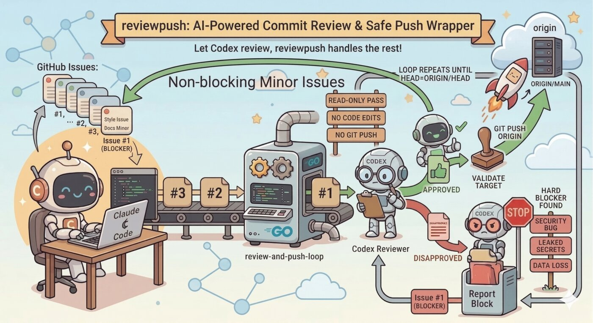

# review-and-push-loop

`review-and-push-loop` pushes your unpushed local commits one at a
time, only after a read-only automated reviewer (Codex CLI by default,
or any custom reviewer command via `--reviewer-cmd`) approves each one.
The reviewer runs read-only and can only answer push or blocked; the
wrapper strictly validates the JSON verdict and runs `git push` itself.
Use it when another agent (such as Claude Code or a `factory` worker)
has written local commits and you want an independent second model or
gate before they reach `origin`.

It pushes to `origin` without asking. For a first try, pass
`--max-iterations 1`.

## Prerequisites

- A reviewer command: by default `codex` on `PATH` and already
  authenticated (set `CODEX_BIN` when the binary has another name), OR
  a custom reviewer command via `--reviewer-cmd` /
  `REVIEWPUSH_REVIEWER_CMD`.
- The repository has a remote named `origin`.
- You have push rights on that remote.

## Quick start

Install:

```bash
go install github.com/jaeyeom/experimental/devtools/reviewpush/cmd/review-and-push-loop@latest
```

Review and push a single commit:

```bash
review-and-push-loop --max-iterations 1
```

Run with a custom reviewer command and machine-readable JSON summary:

```bash
review-and-push-loop --reviewer-cmd "my-reviewer --read-only" --json
```

The Bazel target is `//devtools/reviewpush/cmd/review-and-push-loop`.

Human mode is the default. It fetches, names the commit under review,
prints that commit with `git log --stat --format=fuller -1`, and on a
push prints `Pushed through <commit>.` A finished run ends with
`DONE: HEAD is not ahead of <remote>.`:

```text
Fetching origin/main before iteration 1...
Iteration 1: reviewing and pushing a1b2c3d4e5f6a1b2c3d4e5f6a1b2c3d4e5f6a1b2 (1 commit(s) ahead of origin/main).
========================================
TARGET COMMIT
========================================
commit a1b2c3d4e5f6a1b2c3d4e5f6a1b2c3d4e5f6a1b2
Author:     Ada Lovelace <ada@example.com>
AuthorDate: Sat Nov 14 09:00:00 2026 -0800
Commit:     Ada Lovelace <ada@example.com>
CommitDate: Sat Nov 14 09:00:00 2026 -0800

    Fix the startup path

 main.go | 2 +-
 1 file changed, 1 insertion(+), 1 deletion(-)
========================================
Pushed through a1b2c3d4e5f6a1b2c3d4e5f6a1b2c3d4e5f6a1b2.
DONE: HEAD is not ahead of origin/main.
```

The text between the `========` lines is the `git log` output. The
other lines are what the command prints. `--output compact` skips the
banner and the `Pushed through` line, and it does not stream reviewer
stderr when the pass succeeds. One iteration is a single line:

```text
ITERATION 1 target=a1b2c3d4e5f6 ahead=2 status=PUSH push_target=c3d4e5f6a7b8
DONE base=origin/main
```

`--json` (or `--output json`) suppresses progress banners and emits a
single structured JSON summary on stdout (`status`: `"DONE"`,
`"BLOCKED"`, or `"ERROR"`, plus `base`, `pushed_commits`, `iterations`,
`blocked_commit`, `reason`, and `exit_code`) for programmatic callers
such as scripts, CI, or `factory` workers:

```json
{
  "status": "DONE",
  "base": "origin/main",
  "pushed_commits": ["c3d4e5f6a7b8"],
  "iterations": [
    {
      "iteration": 1,
      "target_commit": "a1b2c3d4e5f6",
      "ahead_count": 2,
      "status": "PUSH",
      "push_target": "c3d4e5f6a7b8",
      "summary": "both commits look clean"
    }
  ],
  "exit_code": 0
}
```

A blocked review in human mode stops like this:

```text
BLOCKED: review-and-push stopped on a1b2c3d4e5f6a1b2c3d4e5f6a1b2c3d4e5f6a1b2.
Reason: hard blocker
```

> "I finally found the proper usage of codex! Review but don't work on the code. It shows its super power when I tell it that the code is written by Claude Code!"

## Options

| Name | Kind | Default | Meaning |
| --- | --- | --- | --- |
| `--repo` | flag | `.` | Repository directory. |
| `--base` | flag | detected | Override base detection (`origin/HEAD`, then `main`, `master`, or `trunk`). |
| `--max-iterations` | flag | `100` | Maximum review and push cycles. Must be greater than zero. |
| `--output` | flag | `human` | `human`, `compact`, or `json`. |
| `--json` | flag | `false` | Emit a single structured JSON summary on stdout (shorthand for `--output json`). |
| `--reviewer-cmd` | flag | `""` | Custom reviewer command (parsed directly without a shell; overrides `REVIEWPUSH_REVIEWER_CMD` and `codex`). |
| `GIT_BIN` | environment | `git` | Git executable. |
| `REVIEWPUSH_REVIEWER_CMD` | environment | `""` | Custom reviewer command when `--reviewer-cmd` is unset. |
| `REVIEWPUSH_TIMEOUT_SECONDS` | environment | `300` | Seconds for each reviewer pass (falls back to `CODEX_TIMEOUT_SECONDS`). `0` waits without a deadline. |
| `CODEX_BIN` | environment | `codex` | Codex executable when using the default Codex adapter. |
| `CODEX_TIMEOUT_SECONDS` | environment | `300` | Legacy timeout alias when `REVIEWPUSH_TIMEOUT_SECONDS` is unset. |

```bash
REVIEWPUSH_TIMEOUT_SECONDS=300 review-and-push-loop --repo . --base main --max-iterations 1 --output human
```

`--max-iterations` below 1, an unknown `--output` value, combining
`--json` with `--output human|compact`, an unclosed quote in
`--reviewer-cmd`, a non-integer timeout, and a base branch that cannot
be detected are configuration errors.

## Exit codes

- `0`: success. `HEAD` is no longer ahead of the remote base branch.
- `1`: configuration error.
- `2`: blocked, push failed, reviewer failed or returned malformed JSON, fetch failed, or the loop hit a guardrail.

## What it does



`review-and-push-loop` repeats the following until `HEAD` is not ahead
of the remote base, or a pass stops the loop:

1. Fetch `origin`.
2. Detect the base branch from `origin/HEAD`, then `main`, `master`,
   or `trunk`. If none of those remote refs exist, use the current
   local branch and treat the remote branch as not created yet, so the
   first push can create it. A detached `HEAD` in that situation is an
   error unless you pass `--base`.
3. Find the oldest local commit ahead of that base. When the remote
   branch does not exist yet, that is the root commit reachable from
   `HEAD`.
4. Start a fresh reviewer process to review that commit. The reviewer is
   told to stay read-only, to inspect Git objects directly, and to
   ignore a dirty work tree unless those local changes affect the
   review.
5. Strictly parse and validate the reviewer's JSON verdict: push, or
   stop because a hard blocker was found. Non-zero exit codes,
   malformed JSON, unknown fields, and contradictory verdicts are
   rejected with no push.
6. Check the commit that would be pushed, then run
   `git push origin <commit>:refs/heads/<base>`.
7. Repeat.

```text
Claude Code writes commits locally

  main
    |
    o  origin/main
    |
    o  C1  "Claude change 1"
    |
    o  C2  "Claude change 2"
    |
    o  C3  "Claude change 3"   <- HEAD

Queue seen by review-and-push-loop:

  oldest ----------------------------------------------> newest
  [ C1 ] -> [ C2 ] -> [ C3 ]

Loop:

  +------------------------+
  | review-and-push-loop   |
  +------------------------+
            |
            v
    pick oldest ahead commit
            |
            v
  +------------------------+
  | Reviewer pass          |
  | read-only              |
  | no code edits          |
  | no git push            |
  +------------------------+
        |            |
   PUSH |            | BLOCKED
        v            v
  validate target    stop the loop
  git push origin
  origin/main moves forward
        |
        v
  queue shrinks:
  [ C2 ] -> [ C3 ]
        |
        v
  repeat until empty
```

With non-blocking findings, the intended human workflow is often:

```text
Reviewer pass
   |
   +--> hard blocker found
   |      -> stop push
   |
   +--> non-blocking concern
          -> push commit anyway
          -> optionally spin off a GitHub issue for follow-up
```

Filing that GitHub issue is not automated. The tool only decides
whether to push or stop, then performs the validated push.

## Architecture & Factory Integration

`review-and-push-loop` is intentionally designed as a **standalone,
composable CLI primitive** (Option B) with an optional, zero-coupling
prompt hook in `factory` (`[output] push_cmd`), rather than embedding
LLM review or `git push` inside `factory verify` or `factory settle`:

- **`factory verify` stays read-only**: `verify` inspects checkout state,
  pull requests, stash counts, and linear history without fetching or
  mutating the repository. Running an LLM reviewer and `git push` inside
  `verify` would break its read-only guarantee.
- **`factory settle` stays post-landing**: `settle` runs *after* work has
  already merged or landed on `origin/<base>` to update claims, close
  tabs, and remove clean worktrees.
- **`[output] mode = "pr"` already has PR review**: in `pr` mode,
  workers push to a feature branch and open a draft PR reviewed via PR
  workflows (`prsync`). `review-and-push-loop` gates direct pushes to
  `<base>` (`refs/heads/<base>`), so it does not belong in `pr` mode.
- **`[output] mode = "merge"` is the natural boundary**: in `merge` mode,
  workers rebase onto `origin/<base>` and push directly to
  `origin/<base>` with no PR gate. Configuring `factory`'s optional
  `[output] push_cmd = "review-and-push-loop --base {base} --json"`
  instructs `merge`-mode workers to push through `review-and-push-loop`
  without introducing any Go package or runtime dependency between
  `factory` and `reviewpush` (see `devtools/AGENTS.md`).
- **Standalone developers & scripts**: developers, subagent
  coordinators, and shell scripts can invoke `review-and-push-loop`
  directly using `--json`, exit codes `0`/`1`/`2`, and `--reviewer-cmd`
  without `factory`, `herdr`, or `codex` installed.

## Review policy

The prompt treats only hard blockers as push-stopping issues:

- security bugs
- leaked secrets
- obvious destructive data loss or corruption
- clearly broken startup or primary-path behavior

Other feedback stays non-blocking. This tool lands the reviewed
commits. It does not ask the reviewer to rewrite the branch.

## Safety properties

Before `git push`, the wrapper verifies the verdict is an unambiguous
push or blocked decision with no contradictory fields, and checks that
the commit it is about to push:

- resolves to a real commit
- is a descendant of the remote base ref, when that ref already exists
- is the oldest commit under review, or a descendant of it
- is an ancestor of `HEAD`

Those checks keep the push inside the contiguous range from the oldest
unpushed commit through `HEAD`. A push of several commits is allowed
only when the reviewer explicitly recommends that, and only through a
commit that passes the same checks. The field names for that
recommendation are in Internals.

## Internals

The Go package behind the command is `reviewpush`.

The reviewer runs behind a narrow `Reviewer` interface (`ReviewPassInput`
-> `ReviewResult`) and never runs `git push`. Each pass is a fresh
process. The wrapper strictly parses and validates the JSON below and is
the only thing that runs `git push`.

### Reviewer response contract

Each pass must return a single JSON object of this shape and nothing
else (no trailing text, no unknown fields):

```json
{
  "status": "PUSH",
  "summary": "brief explanation",
  "multi_commits": false,
  "push_target": "abc123",
  "blocked_reason": null
}
```

When the review stops:

```json
{
  "status": "BLOCKED",
  "summary": "hard blocker found",
  "multi_commits": false,
  "push_target": null,
  "blocked_reason": "security bug"
}
```

`status` is `PUSH` or `BLOCKED`. On `PUSH`, `blocked_reason` must be
null/empty. On `BLOCKED`, `push_target` must be null/empty and the
wrapper does not push.

`multi_commits` is the cross-check for how far to push:

- `false`: push only the commit under review, even when `push_target`
  names a later commit.
- `true`: push through `push_target` (which must be non-empty) after the
  safety checks. That commit must be a descendant of the commit under
  review.

#### Custom reviewer command (`--reviewer-cmd`)

When `--reviewer-cmd` or `REVIEWPUSH_REVIEWER_CMD` is set, `CommandReviewer`
parses the command into argv tokens without a shell, sets working
directory to `--repo`, writes the read-only review prompt to stdin,
exports `REVIEWPUSH_REPO_DIR`, `REVIEWPUSH_BASE_BRANCH`,
`REVIEWPUSH_REMOTE_REF`, `REVIEWPUSH_REMOTE_REF_EXISTS`,
`REVIEWPUSH_ITERATION`, `REVIEWPUSH_AHEAD_COUNT`,
`REVIEWPUSH_TARGET_COMMIT`, and `REVIEWPUSH_SCHEMA_FILE`, and parses and
validates the JSON verdict from stdout. Non-zero exits and malformed or
contradictory JSON reject the pass with exit code `2` and no push.

#### Default Codex adapter

When no custom reviewer command is set, `RealCodexRunner` asks Codex for
this object with `codex exec`. It runs `codex exec --help` and passes
only flags that this Codex binary advertises: `--ask-for-approval`
(`never`, or `--full-auto` when that flag is absent), `--sandbox`
(`workspace-write`, or `danger-full-access` when `TERMUX_VERSION` is
set), `--ephemeral`, `--color` (`never`), `--output-schema`, and
`--output-last-message`.

## Standard CLI protocol

`review-and-push-loop` also implements `github.com/chorong-sh/chorong/pkg/toolcli` subcommands:

- `review-and-push-loop version [--json]`
- `review-and-push-loop update [--check] [--ref <ref>] [--json]`
- `review-and-push-loop doctor [--json] [--offline]`
- `review-and-push-loop skill [install|uninstall|status ...]`
